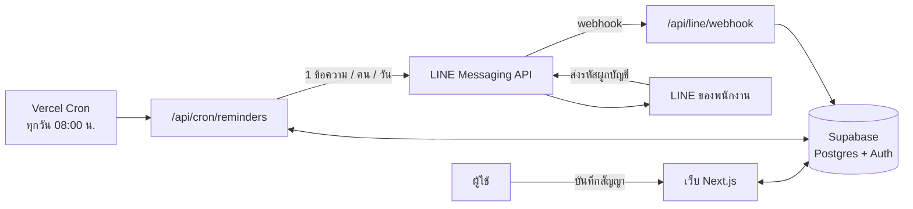
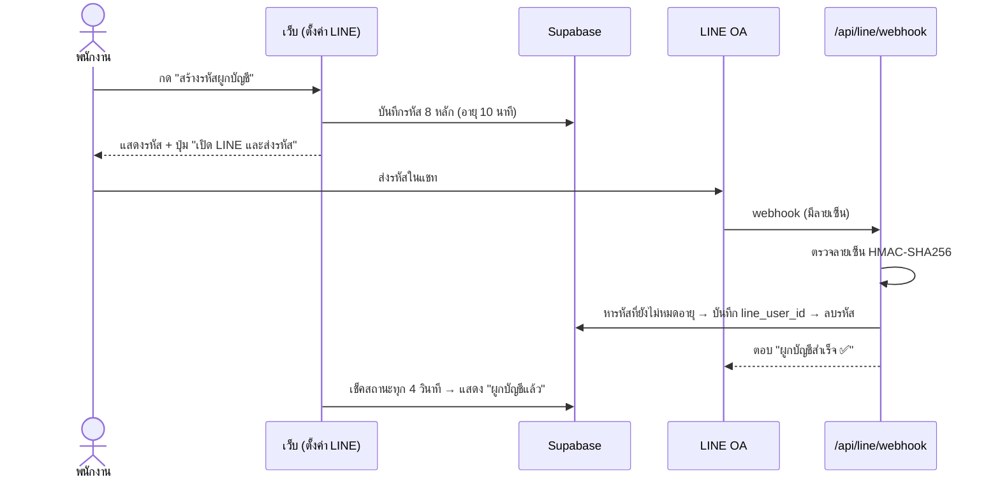

# ระบบแจ้งเตือนสัญญาใกล้หมดอายุ (Contract Reminder)

บันทึกสัญญาบนเว็บ แล้วระบบจะส่ง **LINE** แจ้งผู้รับผิดชอบโดยอัตโนมัติก่อนสัญญาหมดอายุ
ค่าเริ่มต้นแจ้ง **30 วัน / 7 วัน / 1 วัน ก่อน และในวันครบกำหนด** (ปรับได้ต่อสัญญา)

**Stack:** Next.js 16 (App Router, Cache Components) · TypeScript · Supabase (Postgres / Auth / Storage) · LINE Messaging API · Vercel (Hosting + Cron) · Tailwind CSS + shadcn/ui

---

## สารบัญ
- [ฟีเจอร์](#ฟีเจอร์)
- [ภาพรวมระบบ](#ภาพรวมระบบ)
- [การแจ้งเตือนทำงานอย่างไร](#การแจ้งเตือนทำงานอย่างไร)
- [การผูกบัญชี LINE](#การผูกบัญชี-line)
- [สิทธิ์ผู้ใช้และความปลอดภัย](#สิทธิ์ผู้ใช้และความปลอดภัย)
- [ฐานข้อมูล](#ฐานข้อมูล)
- [โครงสร้างโปรเจกต์](#โครงสร้างโปรเจกต์)
- [เริ่มต้นใช้งาน](#เริ่มต้นใช้งาน)
- [การทดสอบ](#การทดสอบ)
- [Deploy](#deploy)
- [ข้อจำกัดและแผนต่อไป](#ข้อจำกัดและแผนต่อไป)

---

## ฟีเจอร์

| หน้า | สิ่งที่ทำได้ |
|---|---|
| **ภาพรวม** | สรุปจำนวนสัญญา หมดอายุแล้ว / ภายใน 7 วัน / ภายใน 30 วัน · 10 รายการที่ใกล้ครบกำหนด · สัญญาที่หมดอายุแต่ยังไม่ปิด · (admin) สถานะการรันแจ้งเตือนล่าสุด และรายการที่ส่งไม่สำเร็จ |
| **สัญญา** | ตารางสัญญาพร้อม badge สีตามวันคงเหลือ · ค้นหาชื่อโครงการ / เลขสัญญา / ลูกค้า · กรองสถานะ · มือถือแสดงเป็นการ์ด |
| **เพิ่ม / แก้ไขสัญญา** | ข้อมูลสัญญา · แบบครั้งเดียวหรือ **ทุกปี** (เช่น ต่ออายุประกัน) · เลือกรอบแจ้ง 90/60/30/14/7/3/1/0 วัน · เลือกผู้รับหลายคน |
| **รายละเอียดสัญญา** | ข้อมูลครบ · ผู้รับและสถานะการผูก LINE · ประวัติการแจ้งเตือน (ส่งแล้ว / ส่งไม่สำเร็จ / ข้าม) · ลบสัญญา |
| **ตั้งค่า LINE** | ผูกบัญชี LINE ด้วยรหัส 8 หลัก (กดปุ่มเดียวเปิด LINE พร้อมรหัส) · ยกเลิกการผูก |

**Badge วันคงเหลือ:** 🟢 มากกว่า 30 วัน · 🟠 8–30 วัน · 🔴 0–7 วัน · ⚪ หมดอายุแล้ว — มีข้อความกำกับเสมอ (ไม่ใช้สีอย่างเดียว)

---

## ภาพรวมระบบ



---

## การแจ้งเตือนทำงานอย่างไร

Vercel Cron เรียก `/api/cron/reminders` ทุกวัน **08:00 น. เวลาไทย** (`0 1 * * *` UTC) แล้วระบบทำ 4 ขั้น:

1. **ดึงข้อมูล** — สัญญาที่ใช้งาน + ผู้รับ + ประวัติการแจ้ง (3 query ไม่วนถามทีละสัญญา)
2. **คำนวณ** — สัญญาแต่ละรายการถึงรอบไหนแล้ว (`computeDue` ใน `src/lib/reminders.ts`)
3. **จองสิทธิ์ส่ง** — บันทึก log สถานะ `pending` ก่อน (มี unique key กันซ้ำ) แล้วส่งเฉพาะแถวที่จองได้
4. **ส่งและบันทึกผล** — รวมทุกสัญญาของคนเดียวกันเป็น **1 ข้อความ** → `sent` / `failed` → บันทึก `cron_runs`

### กติกาการเลือกรอบ
ระบบเลือก **"รอบที่เล็กที่สุดที่ ≥ จำนวนวันคงเหลือ"** ที่ยังไม่เคยส่ง เช่น รอบ `[30, 7, 1, 0]`:

| วันคงเหลือ | ผล |
|---|---|
| 45 | ยังไม่ถึงรอบแรก — ไม่ส่ง |
| 30 | ส่ง "🟢 อีก 30 วัน" |
| 20 | รอบ 30 ส่งแล้ว — ไม่ส่ง |
| 7 | ส่ง "🟠 อีก 7 วัน" |
| 1 | ส่ง "🟠 อีก 1 วัน" |
| 0 | ส่ง "🔴 วันนี้" |
| -1 | เลยกำหนด — ไม่ส่ง |

### กรณีพิเศษ
| กรณี | ระบบทำอย่างไร |
|---|---|
| **ระบบล่ม / สร้างสัญญาทีหลัง** (เช่น เหลือ 5 วันแต่ยังไม่เคยส่ง) | ส่งรอบปัจจุบัน ("อีก 5 วัน") **ครั้งเดียว** และบันทึกรอบที่เลยไปเป็น `skipped` — ไม่ส่งข้อความเก่าย้อนหลัง |
| **สัญญารายปี** | นับจากวันครบรอบถัดไป · 29 ก.พ. ในปีปกติ → 28 ก.พ. · ถ้าวันสิ้นสุดอยู่ในอนาคตหลายปี จะไม่แจ้งก่อนเวลา |
| **ต่อสัญญา** (แก้วันสิ้นสุด) | log ผูกกับ `due_date` → วันใหม่ = รอบใหม่ เริ่มแจ้งตั้งแต่ต้นอัตโนมัติ |
| **ผู้รับยังไม่ผูก LINE / LINE ล่ม** | บันทึก `failed` แล้ว **ส่งใหม่ในรอบ cron ถัดไป** อัตโนมัติ (push ที่ล้มเหลวไม่กินโควตา) |
| **cron ถูกเรียกซ้ำ / ซ้อนกัน** | unique key บน `(contract, user, due_date, offset, channel)` + `X-Line-Retry-Key` → ส่งได้ครั้งเดียว |
| **สัญญาเยอะในวันเดียว** | รวมเป็นข้อความเดียว แสดง 20 รายการแรก + "…และอีก N รายการ" (ไม่เกิน 5,000 ตัวอักษรของ LINE) |
| **สัญญาที่ปิดแล้ว / ไม่มีผู้รับ** | ไม่แจ้ง |

ทุกการคำนวณใช้ **วันที่โซน Asia/Bangkok** (`src/lib/dates.ts`) และแสดงผลเป็น **พ.ศ.**

### ตัวอย่างข้อความ
```
📋 แจ้งเตือนสัญญาใกล้ครบกำหนด 2 รายการ

🔴 วันนี้ — เช่าพื้นที่สำนักงาน (CT-001)
ครบกำหนด 14 ต.ค. 2569

🟠 อีก 7 วัน — บำรุงรักษาระบบ (CT-014)
ครบกำหนด 21 ต.ค. 2569

ดูรายละเอียด: https://<โดเมน>/contracts
```

### โควตา LINE
แผนฟรีส่งได้ **300 ข้อความ/เดือน** — ระบบส่งไม่เกิน 1 ข้อความ/คน/วัน และส่งตรงหาคน (ไม่ส่งเข้ากลุ่มที่นับตามจำนวนสมาชิก) · ข้อความตอบกลับใน webhook ไม่นับโควตา

---

## การผูกบัญชี LINE



- รหัสสุ่มด้วย `crypto.randomInt` · ใช้ได้ครั้งเดียว · หมดอายุ 10 นาที
- เลิกติดตาม OA (unfollow) → ระบบยกเลิกการผูกให้อัตโนมัติ
- LINE เดียวผูกได้ 1 บัญชี — ผูกบัญชีใหม่จะย้ายจากบัญชีเดิม

---

## สิทธิ์ผู้ใช้และความปลอดภัย

| สิทธิ์ | ดูสัญญา | เพิ่ม / แก้ / ลบสัญญา | เปลี่ยนสิทธิ์ผู้อื่น | ดูสถานะระบบ |
|---|:-:|:-:|:-:|:-:|
| `admin` ผู้ดูแลระบบ | ✓ | ✓ | ✓ | ✓ |
| `staff` พนักงาน (ค่าเริ่มต้น) | ✓ | ✓ | | |
| `viewer` ดูอย่างเดียว | ✓ | | | |

**การป้องกันที่มี**
- **Row Level Security** ทุกตาราง — สิทธิ์ตรวจที่ฐานข้อมูล ไม่ใช่แค่หน้าเว็บ
- **Column grant** — ผู้ใช้แก้ได้แค่ชื่อตัวเอง · เปลี่ยน role ตัวเองไม่ได้ · แก้ `line_user_id` ไม่ได้ (เขียนได้เฉพาะ webhook)
- **รหัสผูก LINE** อยู่ในตารางที่ไม่มี policy — ผู้ใช้อ่าน/เขียนไม่ได้เลย (กันขโมยรหัสคนอื่นไปผูก LINE ตัวเอง)
- **Secret key** ใช้เฉพาะฝั่ง server (`import 'server-only'`)
- **Webhook** ตรวจลายเซ็น LINE แบบ timing-safe · **Cron** ต้องมี `CRON_SECRET`
- **ปิดการสมัครเอง** — admin เพิ่มผู้ใช้ผ่าน Supabase
- ทุก Server Action ตรวจสิทธิ์ซ้ำ ไม่พึ่ง `proxy.ts` อย่างเดียว
- ระบบภายใน: `robots.txt` + `noindex` ไม่ให้ search engine เก็บ

---

## ฐานข้อมูล

Schema ทั้งหมดอยู่ใน [`supabase/migrations/0001_init.sql`](supabase/migrations/0001_init.sql)

| ตาราง | เก็บอะไร |
|---|---|
| `profiles` | ผู้ใช้ (ชื่อ, สิทธิ์, LINE user ID) — สร้างอัตโนมัติเมื่อมีผู้ใช้ใหม่ใน Auth |
| `contracts` | สัญญา (ชื่อ, เลขที่, ลูกค้า, วันเริ่ม/สิ้นสุด, ครั้งเดียว/รายปี, รอบแจ้ง, มูลค่า, สถานะ) |
| `contract_recipients` | ผู้รับแจ้งเตือนของแต่ละสัญญา (หลายคนได้) |
| `notification_logs` | ประวัติการแจ้ง + กันส่งซ้ำ (`pending` / `sent` / `failed` / `skipped`) |
| `line_link_codes` | รหัสผูก LINE ชั่วคราว (service role เท่านั้น) |
| `cron_runs` | ประวัติการรันแจ้งเตือนแต่ละรอบ (admin ดูได้) |
| storage `contracts` | bucket ไฟล์ PDF สัญญา (private, ≤ 20 MB) — เตรียมไว้สำหรับเฟส 2 |

ฟังก์ชัน `save_contract()` บันทึกสัญญาและผู้รับ **ในธุรกรรมเดียว** (ไม่มีกรณีบันทึกได้ครึ่งเดียว) และทำงานด้วยสิทธิ์ของผู้เรียก (RLS ยังมีผล)

---

## โครงสร้างโปรเจกต์

```
src/
├─ app/
│  ├─ login/                      หน้าเข้าสู่ระบบ + signIn / signOut
│  ├─ (app)/                      หน้าที่ต้อง login
│  │  ├─ page.tsx                 ภาพรวม
│  │  ├─ contracts/               รายการ · เพิ่ม · แก้ไข · รายละเอียด · actions
│  │  └─ settings/line/           ผูกบัญชี LINE
│  ├─ api/
│  │  ├─ cron/reminders/          งานแจ้งเตือนรายวัน
│  │  └─ line/webhook/            รับข้อความจาก LINE
│  └─ robots.ts
├─ components/                    days-badge, flash-toast, ui/ (shadcn)
├─ lib/
│  ├─ dates.ts                    วันที่โซนไทย, รอบรายปี, แสดงผล พ.ศ.
│  ├─ reminders.ts                เลือกรอบที่ต้องส่ง + สร้างข้อความ   (+ .test.ts)
│  ├─ line.ts                     push / reply / ตรวจลายเซ็น / retry key
│  ├─ auth.ts                     requireUser, requireRole
│  ├─ contracts.ts                วันคงเหลือ, label ภาษาไทย
│  ├─ validations.ts               zod schema ของฟอร์ม
│  └─ supabase/                   server client (cookie) + admin client (secret key)
├─ proxy.ts                       refresh session + ส่งไป /login
└─ types/database.ts              type ของตาราง
supabase/migrations/              schema + RLS
vercel.json                       region sin1 + cron 08:00 น.
```

---

## เริ่มต้นใช้งาน

### สิ่งที่ต้องมี
- Node.js 22+
- บัญชี [Supabase](https://supabase.com), [LINE Developers](https://developers.line.biz) และ [Vercel](https://vercel.com) (ตอน deploy)

### 1. ติดตั้ง
```bash
git clone https://github.com/sariffff/notification-line.git
cd notification-line
npm install
cp .env.example .env.local
```

### 2. Supabase
1. สร้างโปรเจกต์ (region **Singapore**)
2. **SQL Editor** → รันไฟล์ `supabase/migrations/0001_init.sql`
3. **Authentication → Sign In / Providers** → ปิด **Allow new users to sign up**
4. **Authentication → Users → Add user → Create new user** (ติ๊ก Auto Confirm) แล้วตั้งเป็น admin:
   ```sql
   update public.profiles set role = 'admin', full_name = 'ชื่อของคุณ'
   where id = (select id from auth.users where email = 'you@example.com');
   ```
5. (ทางเลือก) generate types ใหม่: `npx supabase gen types typescript --project-id <id> > src/types/database.ts`

### 3. LINE
1. สร้าง LINE Official Account ที่ [LINE Official Account Manager](https://manager.line.biz) → เปิด **Messaging API**
2. [LINE Developers Console](https://developers.line.biz/console) → channel → แท็บ **Messaging API**
   - **Channel access token (long-lived)** → Issue
   - จด **Bot basic ID** (ขึ้นต้น `@`)
   - **Webhook URL** = `https://<โดเมน>/api/line/webhook` → เปิด **Use webhook** → Verify
3. Basic settings → คัดลอก **Channel secret**
4. OA Manager → ตั้งค่าการตอบกลับ → ปิด **Auto-reply** และ **Greeting message**

### 4. ตัวแปรใน `.env.local`
| ตัวแปร | ได้จาก |
|---|---|
| `NEXT_PUBLIC_SUPABASE_URL` | Supabase → Project Settings → API |
| `NEXT_PUBLIC_SUPABASE_PUBLISHABLE_KEY` | Supabase → API Keys → Publishable key (`sb_publishable_…`) |
| `SUPABASE_SECRET_KEY` | Supabase → API Keys → Secret key (`sb_secret_…`) — **ห้ามเปิดเผย** |
| `LINE_CHANNEL_ACCESS_TOKEN` | LINE Developers → Messaging API → Channel access token (~170 ตัวอักษร) |
| `LINE_CHANNEL_SECRET` | LINE Developers → Basic settings → Channel secret |
| `NEXT_PUBLIC_LINE_OA_ID` | Bot basic ID เช่น `@123abcde` |
| `CRON_SECRET` | สุ่มเอง: `openssl rand -hex 32` |
| `APP_URL` | URL ของเว็บ (ใช้ในลิงก์ข้อความ LINE) |
| `LINE_API_BASE` | *(ไม่ต้องตั้ง)* ใช้ชี้ไป mock server ตอนทดสอบเท่านั้น |

### 5. รัน
```bash
npm run dev          # http://localhost:3000
```
ทดสอบ webhook ในเครื่องต้องมี URL สาธารณะ เช่น `cloudflared tunnel --url http://localhost:3000` แล้วเอา URL ไปตั้งเป็น Webhook URL

---

## การทดสอบ

| คำสั่ง | ใช้ทำอะไร |
|---|---|
| `npm test` | unit test — วันที่โซนไทย, รายปี, 29 ก.พ., เลือกรอบ, ส่งชดเชย, retry, ข้อความ |
| `npm run typecheck` | ตรวจ TypeScript |
| `npm run lint` | ESLint |
| `npm run build` | build production |

### ทดสอบ cron ด้วยมือ
ตอน dev ส่ง `?date=` เพื่อจำลองวันที่ได้ (production ปิดไว้) และ `&dry=1` เพื่อดูข้อความโดยไม่ส่งจริง
```bash
S=$(grep ^CRON_SECRET= .env.local | cut -d= -f2)
curl -H "Authorization: Bearer $S" "http://localhost:3000/api/cron/reminders?date=2026-11-06&dry=1"   # ดูอย่างเดียว
curl -H "Authorization: Bearer $S" "http://localhost:3000/api/cron/reminders?date=2026-11-06"         # ส่งจริง
```

---

## Deploy

1. Import repo นี้ใน [Vercel](https://vercel.com/new) (`vercel.json` ตั้ง region `sin1` และ cron ไว้แล้ว)
2. ใส่ Environment Variables ทั้งหมด (`APP_URL` = โดเมนจริง)
3. LINE Developers → เปลี่ยน Webhook URL เป็นโดเมนจริง → Verify
4. Supabase → Authentication → URL Configuration → ใส่โดเมนจริงใน Site URL
5. Supabase → Advisors → ตรวจ Security / Performance
6. Vercel → Settings → Cron Jobs → กด **Run** แล้วดูผลที่หน้าภาพรวม (admin)

> **แผน Vercel:** Hobby (ฟรี) ใช้ได้เฉพาะงานไม่เชิงพาณิชย์ และ cron อาจทำงานคลาดภายในชั่วโมงนั้น — ใช้งานในบริษัท/ให้ลูกค้าควรใช้ **Pro**
> **Supabase ฟรี:** โปรเจกต์ที่ไม่มีการใช้งาน 7 วันจะถูกพัก และไม่มี backup อัตโนมัติ — ใช้งานจริงควรใช้ **Pro**

---

## ข้อจำกัดและแผนต่อไป

**เฟส 2**
- อัปโหลด / ดาวน์โหลดไฟล์ PDF สัญญา (bucket เตรียมไว้แล้ว)
- ปุ่มต่อสัญญา / ปิดสัญญา พร้อมประวัติการต่อ
- หน้าจัดการผู้ใช้และเชิญผู้ใช้ทางอีเมล (ตอนนี้เพิ่มผ่าน Supabase)
- มุมมองปฏิทิน · ปุ่มส่งข้อความทดสอบ · แสดงโควตา LINE

**เฟส 3**
- นำเข้าสัญญาจาก Excel / CSV · ส่งออกรายงาน
- แจ้งเตือนทางอีเมลเป็นช่องทางสำรอง
- ติดตามวันอื่นๆ (หนังสือค้ำประกัน, ประกันภัย, งวดงาน)
- ข้อความ LINE แบบ Flex Message
